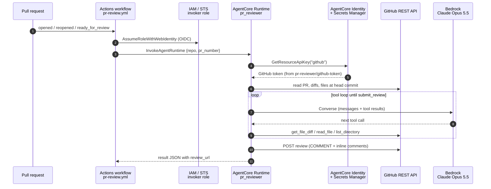
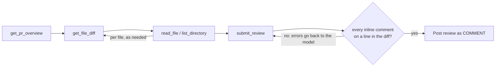
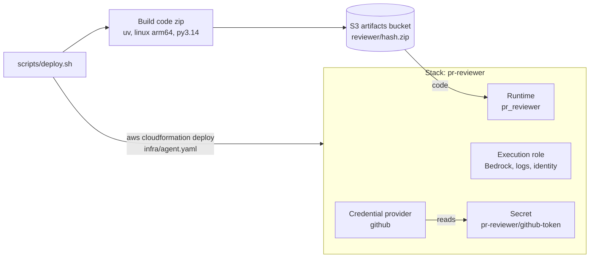

# AgentCore PR Reviewer (POC)

An agent on Amazon Bedrock AgentCore Runtime that peer-reviews GitHub pull requests. It posts a summary review and inline comments.

- **Agent:** Strands Agents + Claude Opus 5.5 on Bedrock (`us.anthropic.claude-opus-5-5`)
- **Runtime:** AgentCore Runtime (code zip, Python 3.14, arm64), deployed with plain CloudFormation (`infra/agent.yaml`)
- **Secrets:** GitHub token in Secrets Manager, exposed to the agent through an AgentCore Identity API key credential (`github`)
- **Trigger:** GitHub Action → OIDC → `bedrock-agentcore:InvokeAgentRuntime`

## Layout

| Path | What |
| --- | --- |
| `app/reviewer/main.py` | AgentCore entrypoint. Payload `{"repo": "owner/name", "pr_number": 1, "dry_run": false}` |
| `app/reviewer/reviewer.py` | Agent tools (overview, diff, read file, list dir, submit review) and posting |
| `app/reviewer/prompts.py` | Review system prompt (the main knob for review quality) |
| `app/reviewer/settings.py` | Runtime settings read from environment variables, with local defaults |
| `app/reviewer/cli.py` | Run a review locally without AgentCore |
| `configs/<env>.yaml` | Per-environment stack parameters (timeouts, retries, model, limits) and tags |
| `infra/agent.yaml` | CloudFormation: runtime, execution role, GitHub token secret, Identity credential provider |
| `scripts/deploy.sh` | Builds the arm64 code zip, uploads it to S3, deploys `infra/agent.yaml` with a config |
| `infra/github-invoker-role.yaml` | IAM role and OIDC provider the workflow assumes |
| `.github/workflows/pr-review.yml` | Workflow to copy into the repos to review |

## How it works

### Request flow



1. A PR is opened, reopened or marked ready for review. You can also run the workflow manually with a PR number.
2. The workflow exchanges its GitHub OIDC token for the invoker role. That role can only call `InvokeAgentRuntime` on this runtime, and no AWS keys are stored in GitHub.
3. It invokes the runtime with `{"repo", "pr_number"}` and waits for up to 15 minutes.
4. The runtime asks AgentCore Identity for the `github` credential, which reads the token from Secrets Manager on every call.
5. The agent reads the PR metadata, diffs and surrounding files from the GitHub API at the head commit.
6. Claude Opus 5.5 on Bedrock drives the tool loop and decides what to read next.
7. The code, not the model, posts one review with a summary and inline comments. It never approves or requests changes.
8. The JSON result, including the review URL, goes back to the workflow log.

### Agent loop inside the runtime



Diffs are annotated with new-file line numbers, so Claude can point comments at exact lines. `submit_review` rejects any comment outside the diff, and the model fixes it before anything is posted. Without that check, GitHub would reject the whole review with a 422.

### Deployment



The zip's S3 key is a hash of the `uv.lock` dependencies and the agent source. If nothing changed, the script skips the build and upload, and the runtime isn't updated. The GitHub token goes into the secret once, outside the template.

The GitHub side is set up once per org from `infra/github-invoker-role.yaml`: the OIDC provider plus the invoker role. PR titles, descriptions and code are treated as untrusted input. The only thing the agent can do on GitHub is post a comment review.

## Prerequisites

- `uv`, AWS CLI v2, `gh`, `zip`, [`yq`](https://github.com/mikefarah/yq) v4
- Bedrock access to Claude Opus 5.5 in `us-east-1`
- A fine-grained GitHub PAT with **Pull requests: read/write** and **Contents: read** on the target repos

## Run locally

```bash
cd app/reviewer
uv sync
uv run pytest
AWS_REGION=us-east-1 uv run python cli.py owner/repo 123          # dry run, prints the review
AWS_REGION=us-east-1 uv run python cli.py owner/repo 123 --post   # posts to GitHub
```

`cli.py` uses `GITHUB_TOKEN` or falls back to `gh auth token`.

## Deploy

```bash
AWS_PROFILE=<your-profile> scripts/deploy.sh sandbox            # deploys with configs/sandbox.yaml
DRY_RUN=1 AWS_PROFILE=<your-profile> scripts/deploy.sh sandbox  # creates the change set only
```

### Configuration

Each environment has a file in [`configs/`](./configs). Its `Parameters` become stack parameters and its `Tags` become stack tags. `StackName`, `Region` and `ArtifactBucket` are optional top-level keys. Strings can use environment variables, e.g. `Branch: $BRANCH_NAME`. To add an environment, copy `configs/sandbox.yaml`.

| Parameter | Default | What it controls |
| --- | --- | --- |
| `IdleSessionTimeout` | 900 | Seconds an idle runtime session is kept |
| `MaxSessionLifetime` | 3600 | Hard limit in seconds on any runtime session |
| `ModelId` | `us.anthropic.claude-opus-5-5` | Bedrock model or inference profile |
| `MaxTokens` | 32000 | Max output tokens per model response |
| `ModelMaxAttempts` | 6 | Agent-level attempts per model call when Bedrock throttles |
| `ModelRetryInitialDelay` / `ModelRetryMaxDelay` | 4 / 240 | Backoff for those attempts, in seconds (doubles each time) |
| `BedrockClientMaxAttempts` | 3 | Bedrock client attempts per request (botocore standard mode) |
| `BedrockReadTimeout` | 120 | Seconds to wait for data on a Bedrock stream |
| `GitHubTimeout` | 30 | Seconds per GitHub API request |
| `GitHubMaxRetries` | 4 | Retries for network errors, 429s, rate limits and 5xx on reads |
| `GitHubRetryBackoff` | 1 | First GitHub retry delay in seconds; doubles each time, and `Retry-After` wins |
| `MaxFileLines` | 800 | Max lines one `read_file` call returns |
| `MaxDescriptionChars` | 6000 | PR description is truncated to this length |

The template passes these to the runtime as environment variables, and [`settings.py`](./app/reviewer/settings.py) reads them. Local runs use the same defaults; override any of them with the environment variable of the same name in upper snake case, e.g. `GITHUB_MAX_RETRIES=0`.

The review POST is retried only when GitHub certainly didn't create the review: connection failures and rate limiting. A 5xx or a timeout on the POST fails the review instead of risking a duplicate.

There is no AgentCore Memory: each review starts fresh.

The script creates the artifact bucket `pr-reviewer-artifacts-<account>-<region>` if it's missing. It builds the zip from `app/reviewer/uv.lock` using Linux arm64 wheels. The zip's S3 key is a hash of the dependencies and sources, so unchanged code doesn't update the runtime.

After the first deploy, put the GitHub PAT into the secret. The agent reads it on every invocation, so no redeploy is needed:

```bash
aws secretsmanager put-secret-value --secret-id pr-reviewer/github-token \
  --secret-string '{"token":"github_pat_..."}'
```

Smoke test:

```bash
echo '{"repo":"owner/repo","pr_number":123,"dry_run":true}' > payload.json
aws bedrock-agentcore invoke-agent-runtime --agent-runtime-arn <RuntimeArn> \
  --runtime-session-id "test-$(uuidgen)" --content-type application/json \
  --payload fileb://payload.json --cli-read-timeout 900 out.json && cat out.json
aws logs tail /aws/bedrock-agentcore/runtimes/<RuntimeId>-DEFAULT --follow
```

Then set up the GitHub side:

```bash
aws cloudformation deploy --region us-east-1 \
  --stack-name agentcore-pr-reviewer-github \
  --template-file infra/github-invoker-role.yaml \
  --capabilities CAPABILITY_NAMED_IAM \
  --parameter-overrides GitHubOrg=<org> AgentRuntimeArn=<RuntimeArn>
```

In each target repo (or at org level), set these variables:

- `AGENTCORE_RUNTIME_ARN`
- `AGENTCORE_INVOKER_ROLE_ARN`
- `AGENTCORE_REGION` (optional; default `us-east-1`)

Then copy `.github/workflows/pr-review.yml` into the repo. A review runs when a PR is opened, reopened or marked ready. You can also run it manually with a PR number.

## POC limitations / next steps

- **PAT instead of a GitHub App.** Move to a GitHub App (OAuth credential provider in AgentCore Identity) for per-repo scoping and a bot identity.
- **Fork PRs** get no OIDC token on `pull_request` events, so they are skipped.
- **No re-review on push.** Re-running posts a new review rather than updating the previous one. Reviews carry an `<!-- agentcore-pr-review -->` marker for later dedup.
- **Synchronous invoke** (about 15 minutes max). Very large PRs may need async invocation, or a cheaper first pass with Sonnet/Haiku via `MODEL_ID`.
- **Repo conventions.** Add a per-repo review guidelines file the agent reads (e.g. `REVIEW.md`), or AgentCore Memory for learned conventions.
- **Evaluation.** AgentCore evaluators (`AWS::BedrockAgentCore::Evaluator`) can score review quality on traces.
